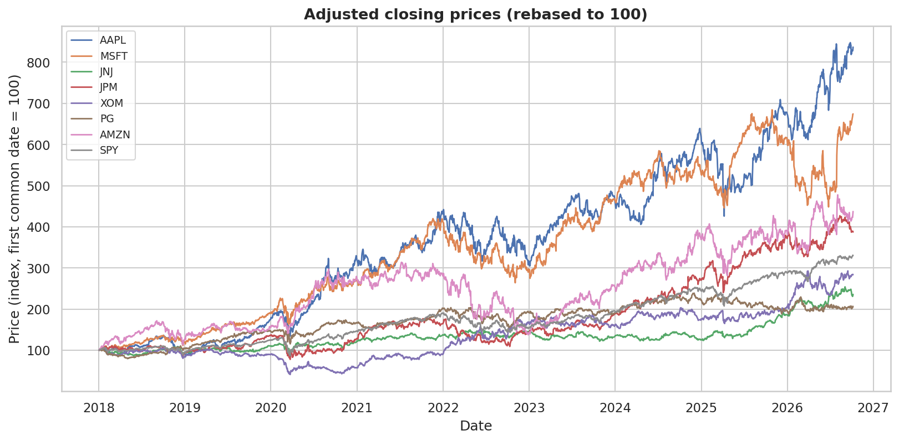
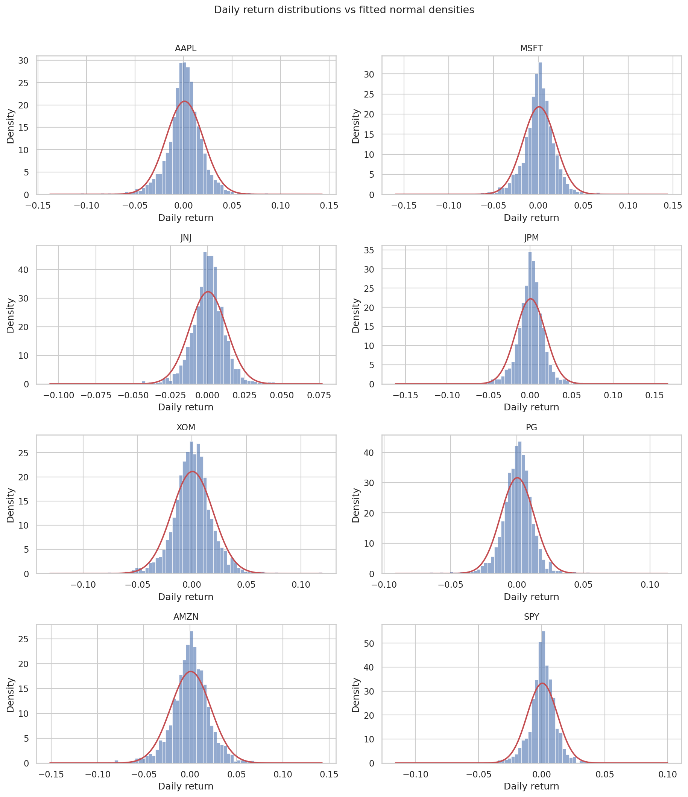
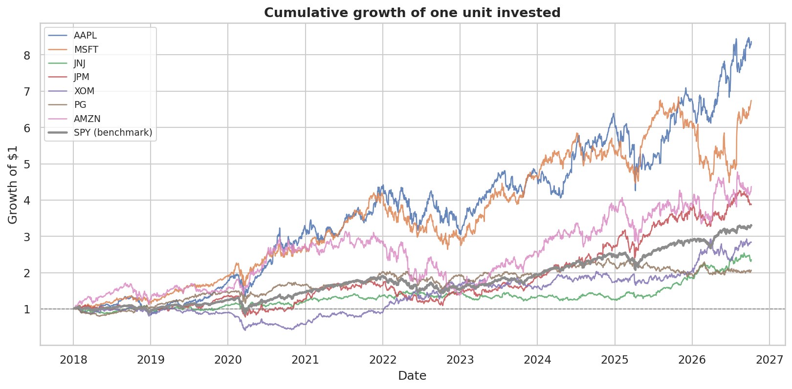
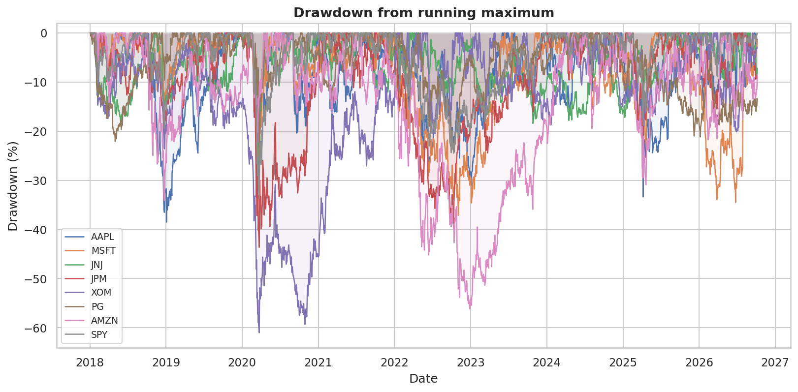
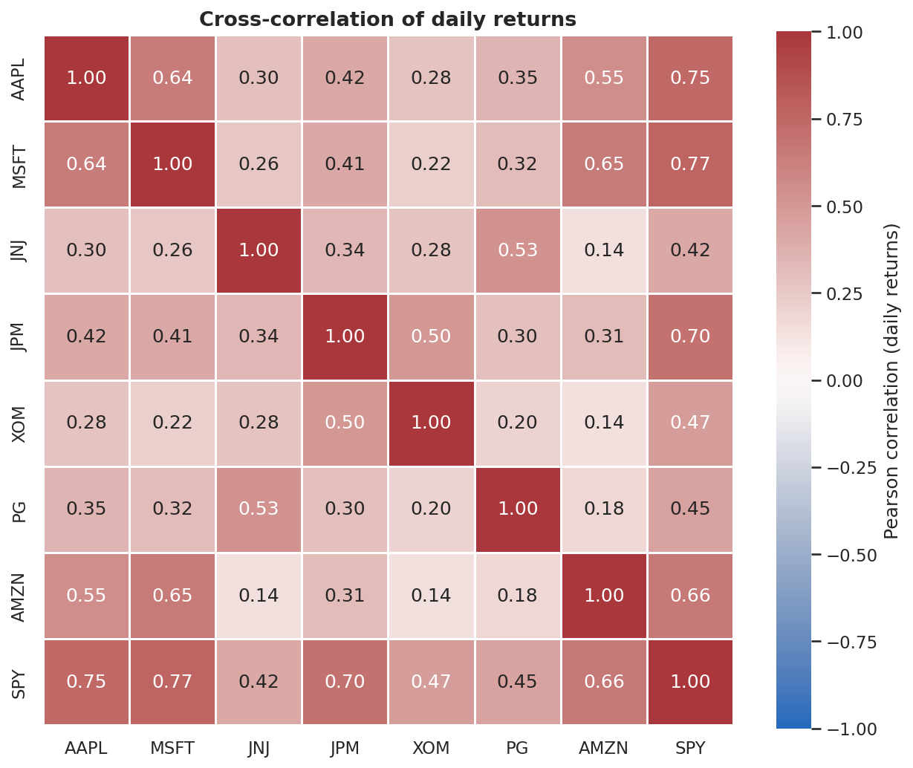
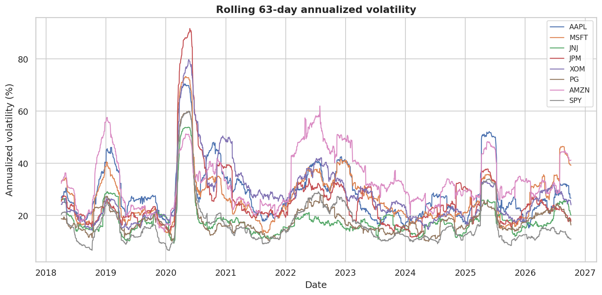

# 1 · finance-data-analysis-lab

[](https://github.com/aydinmonavvari/finance-data-analysis-lab/actions/workflows/ci.yml)


**Descriptive financial analytics on real daily market data — an educational research project.**
Maintained by Aydin Monavvari · Finance × Economics × AI × Data Science × FinTech.

> This repository performs **descriptive analysis only**. It contains no predictions, no
> trading signals and no investment advice. All numbers below are actual outputs of running
> this repository's pipeline on cached Yahoo Finance data (2018-01-02 → 2026-10-07).

## 2 · Short description

`finance-data-analysis-lab` is a small, well-tested Python package plus research write-up that
transforms raw daily adjusted equity prices into interpretable investment and risk information:
return and volatility statistics, Sharpe/Sortino/Calmar ratios, drawdown profiles, benchmark
beta/alpha, correlation structure, and formal distributional/stationarity diagnostics
(Jarque-Bera, Augmented Dickey-Fuller, Ljung-Box). The pipeline is cache-first (offline
reproducible), fully tested (46 unit tests, no network) and lint-clean.

## 3 · Research question

> **How can quantitative analysis transform raw financial market data into interpretable
> investment and risk information?**

The project answers this descriptively: it shows which *computable summaries* (returns,
volatility, drawdown, co-movement, distributional shape, stationarity) turn an opaque matrix of
prices into statements a reader can reason about — and what those statements can and cannot
claim.

## 4 · Motivation

Price series as downloaded are just numbers: 2 203 rows × 8 symbols of adjusted closes carry no
obvious meaning. Before any modelling is defensible, an analyst must be able to say, with
computed evidence, things like:

- how much uncertainty (volatility) each asset carried, and how it varied over time;
- how deep the losses went from past peaks (drawdown);
- whether daily returns are compatible with the Gaussian assumptions many textbook formulas
  silently make;
- whether prices behave like random walks and returns like stationary noise — the empirical
  justification for analysing returns at all.

Graduate-level finance and data-science coursework introduces these tools separately; this
repository wires them into one honest, end-to-end, reproducible pipeline on real data.

## 5 · Why this matters

Descriptive analytics is the foundation every later stage (modelling, forecasting, portfolio
construction) must rest on. If normality fails (it does here, for all 8 series), Gaussian
value-at-risk understates tail risk. If prices are non-stationary but returns are stationary
(they are here), regressing levels on levels is a mistake. Documenting such facts *before*
modelling is a transferable research habit — and the explicit purpose of this lab.

## 6 · Methodology

1. **Ingest** daily adjusted closes for AAPL, MSFT, JNJ, JPM, XOM, PG, AMZN and benchmark SPY
   via `yfinance`, with retries and a per-ticker CSV cache under `data/raw/`
   (cache first, network only on miss; a cache hit is coverage-checked against the
   configured window, so a truncated cache is re-downloaded instead of silently accepted).
2. **Validate** the panel: positive prices, strictly increasing unique business-day index, and
   a documented missing-value policy (forward-fill gaps ≤ 5 trading days; drop unrepaired rows).
3. **Compute** descriptive metrics per symbol: annualized return/volatility, Sharpe, Sortino,
   Calmar, maximum drawdown, beta and alpha versus SPY, rolling statistics.
4. **Test** distributional and time-series properties: Jarque-Bera on log returns, ADF on log
   prices and log returns, Ljung-Box(20) on returns.
5. **Visualise** — six analytical figures (below) with labeled axes and captions.
6. **Report** — machine-readable `reports/metrics.json` and human-readable
   `reports/summary.md`, both generated from the same run that produced this README's numbers.

## 7 · Dataset

| Property | Value (actual run) |
| --- | --- |
| Assets | AAPL, MSFT, JNJ, JPM, XOM, PG, AMZN (+ SPY benchmark) |
| Frequency | Daily, split- and dividend-adjusted close |
| Window | 2018-01-02 → 2026-10-07 (2 203 trading days per symbol) |
| Missing values before cleaning | 0 of 17 624 observations |
| Rows dropped by validation policy | 0 |
| Storage | `data/raw/<TICKER>.csv` (gitignored; `.gitkeep` placeholders kept) |

The universe spans five sectors (technology, healthcare, financials, energy, consumer
staples/discretionary) chosen for liquidity and sector contrast — not for performance.

## 8 · Data sources

- **Yahoo Finance** daily OHLCV, accessed through the open-source
  [`yfinance`](https://github.com/ranaroussi/yfinance) library (`auto_adjust=True`, so the
  "Close" column is the adjusted close). Limitations, honestly stated:
  - Yahoo prices are **delayed and unverified**; they are suitable for education and research,
    not for trading.
  - Adjustment factors are Yahoo's own methodology; historical values can be restated.
  - Occasional rate-limiting: the loader retries with exponential backoff and caches every
    successful download; a failing ticker would be swapped for another liquid ticker and the
    substitution documented (none was needed in the committed run — all 8 symbols cached on
    2026-10-08).
- **Corporate fundamentals are deliberately not used** — this lab studies price-derived
  information only.

## 9 · Architecture

```text
configs/default.yaml
        │  (universe, window, rf assumption, paths)
        ▼
┌────────────────────────────────────────────────────────────────────┐
│ src/finance_data_analysis_lab/                                     │
│                                                                    │
│  data.py ──────────► yfinance download + CSV cache + validation    │
│      │               (cache first, retries, data contract)         │
│      ▼                                                             │
│  metrics.py ───────► returns · ann. return/vol · Sharpe/Sortino/   │
│      │               Calmar · drawdown · beta/alpha · rolling      │
│      ▼                                                             │
│  stats_tests.py ───► Jarque-Bera · ADF · Ljung-Box (tidy dicts)    │
│      ▼                                                             │
│  plots.py ─────────► 6 matplotlib figures (labeled, captioned)     │
│      ▼                                                             │
│  pipeline.py ──────► orchestrates all of the above, writes         │
│                        reports/metrics.json + reports/summary.md   │
└────────────────────────────────────────────────────────────────────┘
        │                              │
        ▼                              ▼
   figures/*.png                 reports/*.{json,md}
   tests/ (46, offline)      scripts/{download_data,run_analysis}.py
```

## 10 · Experimental / analytical design

- **Design type:** observational, descriptive, single-sample (no train/test splits — nothing is
  fitted for prediction; statistical tests are the only "models").
- **Price basis:** adjusted close (see [§8](#8--data-sources)); simple returns for risk and
  benchmark-relative metrics, log returns for distributional diagnostics (additivity over time).
- **Statistical decisions fixed in advance:** annualization by 252 trading days; Sharpe/Sortino
  computed with the configurable `rf_annual` (0.0 in the committed run); ADF with AIC lag
  selection; Ljung-Box at lag 20 (≈ one trading month); significance level 5%.
- **Determinism:** no randomness in the pipeline (a seed is set anyway); every statistic and
  figure is regenerable from the cache with two commands (see [§16](#16--reproducibility));
  the only run-varying field in the outputs is the `generated_at` timestamp.

## 11 · Methods & metrics

With adjusted prices $P_t$, daily simple returns $r_t = P_t/P_{t-1} - 1$ and log returns
$\ell_t = \ln(P_t/P_{t-1})$, and $N = 252$ trading days per year:

- **Annualized (geometric) return** — $\big(P_T/P_0\big)^{N/n} - 1$, with $n$ daily intervals.
- **Annualized volatility** — $\hat\sigma(r_t)\cdot\sqrt{N}$ (sample std, `ddof=1`).
- **Sharpe ratio** (Sharpe, 1966) —
  $\dfrac{\bar r_t \cdot N - r_f}{\hat\sigma(r_t)\cdot\sqrt{N}}$; the risk-free assumption
  $r_f$ is configurable (`rf_annual = 0.0` in the committed run) and stated on every result.
- **Sortino ratio** — like Sharpe but the denominator uses only squared shortfalls below the
  daily target $r_f/N$: $\sqrt{\tfrac{1}{n}\sum \min(r_t - r_f/N,\,0)^2}\cdot\sqrt{N}$.
- **Calmar ratio** — annualized return divided by $|$max drawdown$|$.
- **Drawdown series / max drawdown** — $DD_t = P_t/\max_{s\le t} P_s - 1$; MDD $= \min_t DD_t$.
- **Beta / alpha vs SPY** — OLS slope $\beta = \mathrm{cov}(r_i, r_m)/\mathrm{var}(r_m)$ on
  aligned dates; annualized arithmetic alpha
  $(\bar r_i - \beta \bar r_m)\cdot N$ (a non-compounded approximation to Jensen's alpha).
- **Jarque-Bera** — normality of log returns via skewness and kurtosis.
- **Augmented Dickey-Fuller** — unit-root test on log prices (expect non-stationarity) and log
  returns (expect stationarity).
- **Ljung-Box(20)** — joint null of zero autocorrelation up to lag 20 on daily returns.

All formulas are implemented once in `src/finance_data_analysis_lab/metrics.py` and
`stats_tests.py` and pinned by hand-computed unit tests.

## 12 · Evaluation metrics

Because this is a descriptive study, "evaluation" means **verification of the analytics**, not
forecast scoring:

- **Unit tests (46, offline, synthetic):** every metric is checked against hand-derived values
  (e.g. Sharpe of a known series, a −50% drawdown path, β = 2 by construction); the validator
  must reject unsorted indices, duplicate dates and non-positive prices; white noise must not
  be flagged by Jarque-Bera/Ljung-Box while trending series must fail ADF.
- **Linting:** `ruff check .` (rules E, F, W, I, B, UP), line length 100.
- **Reproducibility check:** `run_analysis.py` on the local cache regenerates every figure
  and both reports with zero network access.

## 13 · Results

Actual output of the committed pipeline run (2026-10-08, `rf_annual = 0.0`, sample
2018-01-02 → 2026-10-07, 2 203 trading days). Machine-readable source:
[`reports/metrics.json`](reports/metrics.json).

**Return and risk metrics (sorted by Sharpe):**

| Ticker | Ann. return | Ann. vol | Sharpe | Sortino | Calmar | Max drawdown | Beta (vs SPY) | Alpha (ann., vs SPY) |
| --- | --- | --- | --- | --- | --- | --- | --- | --- |
| AAPL | 27.52% | 30.43% | **0.95** | 1.40 | 0.71 | −38.52% | 1.20 | 10.34% |
| MSFT | 24.41% | 29.08% | 0.90 | 1.33 | 0.66 | −37.15% | 1.17 | 7.90% |
| SPY | 14.65% | 18.98% | 0.82 | 1.15 | 0.43 | −33.72% | 1.00 | 0.00% |
| JPM | 16.76% | 28.52% | 0.69 | 1.01 | 0.38 | −43.63% | 1.05 | 3.26% |
| AMZN | 18.39% | 34.43% | 0.66 | 0.98 | 0.33 | −56.15% | 1.20 | 4.24% |
| JNJ | 10.32% | 19.63% | 0.60 | 0.85 | 0.38 | −27.37% | 0.43 | 5.05% |
| XOM | 12.68% | 29.97% | 0.55 | 0.79 | 0.21 | **−61.01%** | 0.75 | 4.88% |
| PG | 8.62% | 20.03% | **0.51** | 0.74 | 0.36 | −23.77% | 0.47 | 2.95% |

**Statistical diagnostics (actual test output):**

| Ticker | JB p-value (log returns) | Skew | Excess kurtosis | ADF p (log price) | ADF p (log return) | LB(20) p (returns) |
| --- | --- | --- | --- | --- | --- | --- |
| AAPL | < 0.001 | −0.12 | 6.10 | 0.778 | < 0.001 | < 0.001 |
| MSFT | < 0.001 | 0.00 | 8.12 | 0.555 | < 0.001 | < 0.001 |
| JNJ | < 0.001 | −0.41 | 8.50 | 0.964 | < 0.001 | < 0.001 |
| JPM | < 0.001 | −0.09 | 12.91 | 0.954 | < 0.001 | < 0.001 |
| XOM | < 0.001 | −0.23 | 5.24 | 0.919 | < 0.001 | 0.0002 |
| PG | < 0.001 | −0.06 | 9.39 | 0.417 | < 0.001 | < 0.001 |
| AMZN | < 0.001 | 0.02 | 4.63 | 0.372 | < 0.001 | **0.129** |
| SPY | < 0.001 | −0.57 | 13.67 | 0.945 | < 0.001 | < 0.001 |

**Figures (generated by the pipeline from the cached data):**



*Figure 1 — Adjusted closes rebased to 100 at the first common date. Growth dispersion over the
sample is large: AAPL grows ≈ 8.4× from its base (total return +736.8%), PG ≈ 2.1× (+106.0%),
while the paths of XOM and JNJ show multi-year stagnation despite dividends included in the
adjustment.*



*Figure 2 — Daily log-return histograms with the Gaussian of matching mean/variance overlaid.
Every panel is visibly more peaked with occasional extreme observations (2020 and 2022 stress
episodes) than its fitted curve — the visual counterpart of the Jarque-Bera rejections in the
diagnostics table.*



*Figure 3 — Growth of one unit invested at the start of the sample vs the SPY benchmark. The
2020 COVID crash and 2022 bear market appear as common drawdowns; the technology names recover
fastest in this sample.*



*Figure 4 — Drawdown from each series' running maximum. XOM spent long stretches more than 40%
below its 2018 peak (max −61.0%); PG and JNJ were the shallowest (−23.8%, −27.4%); even the
benchmark fell 33.7% peak-to-trough.*



*Figure 5 — Pearson correlations of daily returns. SPY–MSFT (0.77) and SPY–AAPL (0.75) are the
strongest pairs, as expected for a market benchmark; excluding SPY, the strongest pairs are
MSFT–AMZN (0.65) and AAPL–MSFT (0.64). XOM and the defensive names (PG, JNJ) correlate least
with the technology cluster (e.g. JNJ–AMZN 0.14) — consistent with, but not proof of, sector
structure.*



*Figure 6 — 63-day rolling annualized volatility. Volatility is clearly time-varying and
co-moves across the universe: spikes in March 2020 and in 2022 lift even the low-volatility
defensives, illustrating why single-number volatility summaries are incomplete.*

## 14 · Interpretation

Within this sample, and read **descriptively**:

- **Risk ordering is not return ordering.** The two lowest-volatility assets (SPY 19.0%, JNJ
  19.6%) were mid-pack on return; the highest-return asset (AAPL) carried 30.4% volatility. The
  Sharpe column condenses the trade-off, but it is a *sample* summary (see §15).
- **Drawdowns dwarf average returns.** Annualized returns of 8–28% coexist with peak-to-trough
  losses of 24–61%: for long-horizon holders, the deepest drawdown was typically 2–4× the
  annualized return in magnitude. Calmar ratios (0.21–0.71) make the same point compactly.
- **Gaussian assumptions fail everywhere.** Jarque-Bera rejects normality for all 8 series
  (p < 0.001; excess kurtosis 4.6–13.7, seven of eight negatively skewed). Formulas assuming
  i.i.d. normal returns (e.g. naive σ-scaled VaR) understate observed tail frequencies.
- **Prices walk, returns don't.** ADF fails to reject the unit root on log prices for all 8
  series (p = 0.37–0.96) and rejects it on log returns for all 8 (p < 0.001) — the standard
  empirical justification for modelling returns rather than levels.
- **Weak but real autocorrelation.** Ljung-Box(20) rejects independence for 7 of 8 series
  (AMZN is the exception, p = 0.129). For liquid large caps this is small in economic terms but
  cautions against treating daily returns as independent draws.
- **Benchmark-relative views add context, not validation.** Betas span 0.43 (JNJ) to 1.20
  (AAPL, AMZN); annualized alphas are positive for all seven stocks in this window — a fact
  about this sample of currently-listed large caps (survivorship, §15), not evidence of skill
  or of future alpha.

## 15 · Limitations

Stated plainly, because they bound every claim above:

1. **Data quality.** Yahoo Finance daily bars are delayed, unverified and occasionally restated;
   adjustment methodology is Yahoo's own. No cross-source verification was performed.
2. **Survivorship bias.** The universe consists of *currently listed* large caps. Delisted or
   de-indexed firms from 2018–2026 are absent, which flatters universe-level statistics (e.g.
   the uniformly positive alphas).
3. **No microstructure.** Daily closes ignore intraday information, bid-ask spreads, liquidity
   and halts.
4. **Simplified rates.** `rf_annual = 0.0` treats funding cost as zero; Sharpe/Sortino levels
   (not orderings) shift with the assumption.
5. **No frictions.** No transaction costs, taxes, or capacity constraints; "alpha" here is a
   statistical residual, not an implementable edge.
6. **Single sample.** One window (2018–2026, dominated by two stress episodes and a technology
   rally). Ranks are window-sensitive; nothing here is a forecast.
7. **Statistical scope.** Pearson correlation and OLS beta capture linear, average
   relationships only; tail dependence and regime shifts are not modelled.

## 16 · Reproducibility

Exact commands (Python ≥ 3.11; the committed run used 3.12):

```bash
git clone https://github.com/aydinmonavvari/finance-data-analysis-lab.git
cd finance-data-analysis-lab
pip install -e ".[dev]"

# 1) fetch/cache the data (network; skipped for already-cached symbols)
python scripts/download_data.py            # add --refresh to force re-download

# 2) run the full pipeline offline from the cache
python scripts/run_analysis.py             # regenerates figures/ + reports/

# 3) verify: lint + 46 offline unit tests
ruff check .
python -m pytest tests/ -q
```

The local `data/raw/*.csv` cache (git-ignored by policy, so a fresh clone re-downloads it)
reproduces every number in this README with the two commands in steps 2–3. The loader also
checks that a cached series actually covers the configured window — a truncated cache is
re-downloaded (or rejected with a clear error offline) rather than silently shortening the
study.

## 17 · Installation

```bash
# with pip
pip install -e ".[dev]"

# or just the runtime dependencies
pip install -r requirements.txt
```

Requirements: Python ≥ 3.11; pandas ≥ 2.0, numpy ≥ 1.24, scipy ≥ 1.10, statsmodels ≥ 0.14,
matplotlib ≥ 3.7, seaborn ≥ 0.12, yfinance ≥ 0.2.40, pyyaml ≥ 6.0 (dev: pytest ≥ 8.0,
ruff ≥ 0.4). No API keys or secrets are needed — Yahoo Finance's public endpoints suffice.

## 18 · Usage

```bash
python scripts/download_data.py --refresh   # refresh the price cache
python scripts/run_analysis.py              # full pipeline -> figures/ + reports/

# or as a library
```

```python
from finance_data_analysis_lab.config import load_config
from finance_data_analysis_lab.pipeline import run_pipeline

result = run_pipeline(load_config())        # dict: validation, metrics, artifacts
```

Configuration lives in `configs/default.yaml` (tickers, benchmark, window, `rf_annual`,
paths); edit it and re-run — every downstream number and figure follows.

## 19 · Example

```python
import pandas as pd
from finance_data_analysis_lab.config import load_config
from finance_data_analysis_lab.data import load_price_frame, validate_prices
from finance_data_analysis_lab import metrics

config = load_config()
raw = load_price_frame(config.all_symbols, config.start, config.end, config.raw_dir)
prices, report = validate_prices(raw)

aapl_returns = metrics.simple_returns(prices["AAPL"])
{
    "annualized_return": round(metrics.annualized_return(prices["AAPL"]), 4),
    "annualized_volatility": round(metrics.annualized_volatility(aapl_returns), 4),
    "sharpe": round(metrics.sharpe_ratio(aapl_returns, config.rf_annual), 3),
    "max_drawdown": round(metrics.max_drawdown(prices["AAPL"]), 4),
}
# Expected output shape (values from the committed run):
# {'annualized_return': 0.2752, 'annualized_volatility': 0.3043,
#  'sharpe': 0.951, 'max_drawdown': -0.3852}
```

## 20 · Project structure

```text
finance-data-analysis-lab/
├── README.md                  # this document (23 sections, actual results)
├── LICENSE                    # MIT © 2026 Aydin Monavvari
├── CITATION.cff               # citable metadata (CFF 1.2.0)
├── pyproject.toml             # PEP 621 packaging, ruff + pytest config
├── requirements.txt
├── .python-version            # 3.12
├── .github/workflows/ci.yml   # ruff + pytest on push/PR
├── configs/default.yaml       # universe, window, rf assumption, paths
├── src/finance_data_analysis_lab/
│   ├── __init__.py            # __version__
│   ├── config.py              # Config dataclass + YAML loader
│   ├── data.py                # yfinance download, CSV cache, validation
│   ├── metrics.py             # returns, risk & performance metrics
│   ├── stats_tests.py         # Jarque-Bera, ADF, Ljung-Box wrappers
│   ├── plots.py               # 6 analytical matplotlib figures
│   └── pipeline.py            # orchestration -> reports + figures
├── scripts/
│   ├── download_data.py       # CLI: fetch/cache all symbols
│   └── run_analysis.py        # CLI: full analysis pipeline
├── tests/                     # 46 offline tests (synthetic fixtures)
│   ├── test_metrics.py
│   ├── test_data_validation.py
│   └── test_stats_tests.py
├── notebooks/
│   └── 01_exploratory_analysis.ipynb   # executed EDA on the cached data
├── data/                      # raw/ + processed/ (gitignored, .gitkeep kept)
├── figures/                   # 6 generated PNGs (committed)
├── reports/                   # metrics.json + summary.md (committed)
└── docs/research_report.md    # full research write-up with references
```

## 21 · Future work

- Replace the flat `rf_annual` with a daily risk-free series (e.g. 13-week T-bill from FRED)
  and re-state excess-return metrics.
- Add non-Gaussian tail summaries (historical/Cornish-Fisher VaR, expected shortfall) that the
  Jarque-Bera results motivate.
- Time-varying beta/correlation (rolling or EWMA; DCC-style views) instead of full-sample OLS.
- Sector-consistent, survivorship-aware universe construction from point-in-time index
  constituents.
- A written replication study varying the sample window to quantify how unstable Sharpe
  rankings are — an honest follow-up to §14.
- Optional: small forecasting baseline (e.g. GARCH volatility) *clearly separated* as
  prediction, beyond this repository's descriptive scope.

## 22 · Citation

If you use or adapt this project, please cite it (see also `CITATION.cff`):

```bibtex
@software{monavvari2026financedataanalysislab,
  author  = {Monavvari, Aydin},
  title   = {finance-data-analysis-lab: descriptive financial analytics
             on real daily market data},
  year    = {2026},
  version = {1.0.0},
  date    = {2026-10-08},
  url     = {https://github.com/aydinmonavvari/finance-data-analysis-lab},
  license = {MIT}
}
```

Key methodological references: Sharpe (1966); Markowitz (1952); Fama (1970) — full list in
[`docs/research_report.md`](docs/research_report.md).

## 23 · License

MIT License — see [`LICENSE`](LICENSE). © 2026 Aydin Monavvari.

*Disclaimer: this repository is an educational research project. Nothing in it constitutes
investment advice, a recommendation, or an offer to buy or sell any security. Past performance
described here does not predict future results.*
